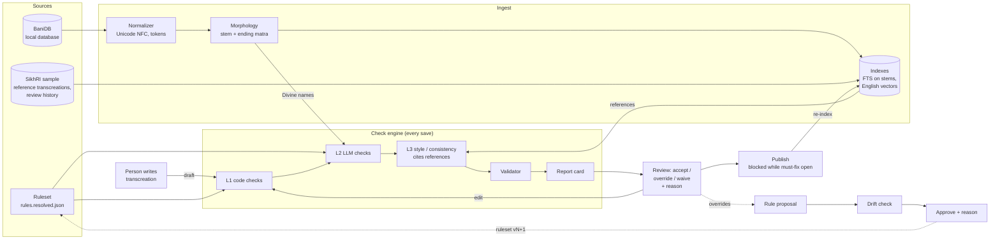
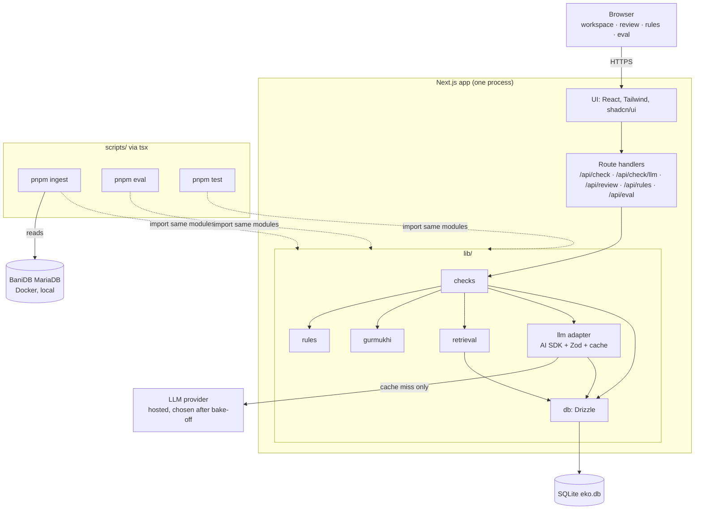

# 03 · Architecture

How Eko fits together: the logical flow, the runtime, the stack, the records, and what crosses the LLM boundary. Diagrams are Mermaid (they render on GitHub and in most Markdown viewers). A visual version with annotated diagrams is in [architecture.html](architecture.html).

## Core design decision

**Gurmukhi is handled by code; the LLM only judges English.** General-purpose LLMs are unreliable on Gurbani morphology, and a mistake there would be confident and hard to spot. So code finds what's on the BaniDB line (for example, which Divine name it uses), packages that as structured evidence, and the LLM judges whether the English transcreation respects it. A validator then rejects any finding that quotes words not in the draft or cites IDs that don't exist.

## Logical flow



Two loops run at different speeds. The **edit loop** (edit → re-check) runs many times per Sabad. The **rule loop** (proposal → drift check → approval with a reason) changes the ruleset only after a person approves it.

## Runtime architecture

One Next.js process and one SQLite file. BaniDB is read only by the ingest script, never at request time. The LLM is reached only through the adapter.



## Stack

| Layer | Choice | Why | Considered instead |
|---|---|---|---|
| App | Next.js (App Router), TypeScript strict | UI and API in one repo and one process; one language for the team | Separate API + SPA (two deploys) |
| UI | Tailwind CSS, shadcn/ui, Noto Sans Gurmukhi | Accessible components fast; findings highlighted by character offsets | Rich-text editor |
| Database | SQLite, better-sqlite3, Drizzle ORM | No server; the whole state is one file | Postgres |
| Gurbani source | `khalisfoundation/banidb-dev` (MariaDB) in Docker, read with mysql2 at ingest | Offline, no rate limits, same data the BaniDB API serves | Hosted API |
| Word lookup | SQLite FTS5 over stem and stem + ending keys | Exact word identity across spellings | Vector search on Gurmukhi |
| English similarity | Embeddings in SQLite, cosine similarity in TypeScript | Sample is small; a loop is fast enough | Vector database |
| Embedding model | Transformers.js, all-MiniLM-L6-v2, local | Good enough for the proof of concept, no API key | Provider embeddings API if speed or quality bites |
| LLM access | Vercel AI SDK `generateObject` + Zod | One-line provider swap; typed output or an error | Per-provider clients |
| LLM caching | `llm_cache` keyed by hash(model, prompt version, packet) | Repeatable backtest; pays once per question | No cache |
| Concurrency | p-limit, about 4 LLM calls at once | Stays under provider limits without a queue | Job queue |
| Tests | Vitest golden tests per rule | Code checks pass before LLM work starts | |
| Rules authoring | `resolve.py` → `rules.resolved.json` | Decisions edited in one place; the app loads JSON | Porting to TypeScript |
| Hosting | Laptop for the recorded demo; Fly.io with a volume for a shareable link | SQLite needs a persistent disk | Vercel (no persistent local files) |
| Secrets | `.env.local`, never committed | | |

Pin exact library versions at scaffold time, and check the AI SDK's current API names against its docs then.

## Check engine

| Layer | What runs | Rules |
|---|---|---|
| L1 code checks | Deterministic, under a second, no network | TERM-01 (capitalized), LAYER-07, TERM-03, TERM-07 (spellings), LAYER-06 (closed list) |
| L2 LLM checks | Only (line, rule) pairs a prefilter selects | TERM-02, PRIN-04, plus confirmation tiers for TERM-01 lowercase, TERM-07 substitutes, LAYER-06 ambiguous words |
| L3 style and consistency | Retrieve reference renderings; LLM explains drift, cites IDs | CONS-01, style check (FR-09); needs SikhRI's sample |
| Validator | Drops findings with a span not in the draft or unknown IDs | All |

Rule details and severities: [04-ruleset.md](04-ruleset.md).

### What happens on save

```
POST /api/check            code checks; returns at once
  diff draft → changed tukks
  L1 rules → findings → save → report card shows them

POST /api/check/llm        the UI calls this right after
  prefilters pick (line, rule) pairs
  build a packet per pair
  cache hit ? use it : adapter call
  validator drops bad spans / IDs
  save → report card updates
```

Two calls instead of streaming keeps the build simple: code findings appear instantly, model findings a few seconds later.

## What crosses the LLM boundary

Code builds the packet at check time. Ingest precomputes the Gurmukhi side (lines, stems, Divine names); the draft, the rule and the references are added per check. The LLM never receives a request to write English.

**Packet → LLM** (illustrative)

```json
{
  "line_id": "L-000123",
  "gurmukhi": "<from BaniDB>",
  "divine_terms": [{ "surface": "ਕਰਤਾ", "attribute": "Creator" }],
  "english_draft": "The Lord sustains all creation.",
  "layer": "transcreation",
  "rule": {
    "id": "TERM-02",
    "level": "MUST",
    "text": "Retain the specific Divine attribute the original Sabad uses …",
    "plan": "grammar_conditioned"
  },
  "references": [{ "id": "T-0456", "english": "…" }]
}
```

**Finding ← LLM**, then validated

```json
{
  "rule_id": "TERM-02",
  "verdict": "flag",
  "quoted_span": "The Lord",
  "explanation": "The line names the Divine as Creator (ਕਰਤਾ); the draft collapses it into 'Lord'.",
  "reference_ids": ["T-0456"],
  "layer": "L2"
}
```

The validator drops this finding if "The Lord" isn't in the draft or if TERM-02 or T-0456 doesn't exist. The same draft also fails TERM-01, but that's caught by L1 and never reaches the model.

| Packet field | Comes from | When |
|---|---|---|
| line_id, gurmukhi, ang, raag, writer | BaniDB | Ingest, once |
| words, stems, Divine names | Normalizer + morphology | Ingest, once |
| reference index | SikhRI sample | Ingest; re-run when something is published |
| english_draft | The person writing | Check time |
| rule | Ruleset → prefilter | Check time |
| references | Retrieval | Check time |

## Core records

One SQLite file. Shapes carry over to Postgres later.

| Record | Key fields | Written by |
|---|---|---|
| Line · Word | `line_id, shabad_id, ang, raag, writer, is_rahao`; word: `surface, stem, ending, features` | Ingest, from the local BaniDB database |
| Rule | `id, text, level, layers, plan, severity, decision, version, status, approved_by, approved_at, reason` | Anyone, with a reason |
| Draft | `id, line_ids[], layer (transcreation), text, author, status` | Anyone |
| Finding | `id, draft_id, rule_id, layer (L1, L2, style), severity, quoted_span, start, end, explanation, reference_ids[], rule_version, model, prompt_version` | Engine |
| Decision | `finding_id, action (accept, override, waive), reason, reviewer, at` | Anyone reviewing |
| Proposal | `id, source (free_text, overrides), rule_text, example, reason, evidence_ids[], author` | Anyone; engine for P1 override proposals |
| Drift result | `proposal_id, check, outcome (pass, warn, block), evidence, overridden_by, reason` | Engine; anyone overriding |
| Reference | `id, line_ids[], english, source (sikhri_sample, published), waived_rule_ids[]` | Sample import; publishing |
| LLM cache | `key (hash), model, prompt_version, response, created_at` | Adapter |
| Eval run | `id, ruleset_version, n_corrections, catch_rate, false_flag_rate, per_rule` | Backtest |

## Drift check

Runs on every proposed rule before anyone approves it. Anyone can override a block, with a reason that stays on the rule's record.

| Check | How | Outcome |
|---|---|---|
| Contradiction | Retrieve related rules; LLM labels each pair contradicts / overlaps / unrelated, with a reason | Block |
| Published-line replay | Run the proposed rule over every published transcreation and count the lines it would flag | Block above a threshold; lists affected lines |
| Glossary collision | Compare new renderings with existing preferred renderings | Block |
| Duplicate (P1) | Similarity against existing rules | Warn; suggest merge |
| Scope change (P1) | LLM compares with the rule it narrows or broadens | Warn; show both |

Published-line replay is the strongest signal: it measures drift against SikhRI's actual work, not a model's opinion.

## Backtest (beat 6)

1. Take pre-edit drafts from SikhRI's review history; run the engine on them.
2. **Catch rate** = corrections Eko flagged ÷ all corrections reviewers made.
3. **False-flag rate** = findings on spans reviewers left unchanged ÷ all findings.
4. Tag typo and out-of-scope corrections separately so they don't distort the catch rate.
5. Store per ruleset version, so adding a rule shows its effect.
